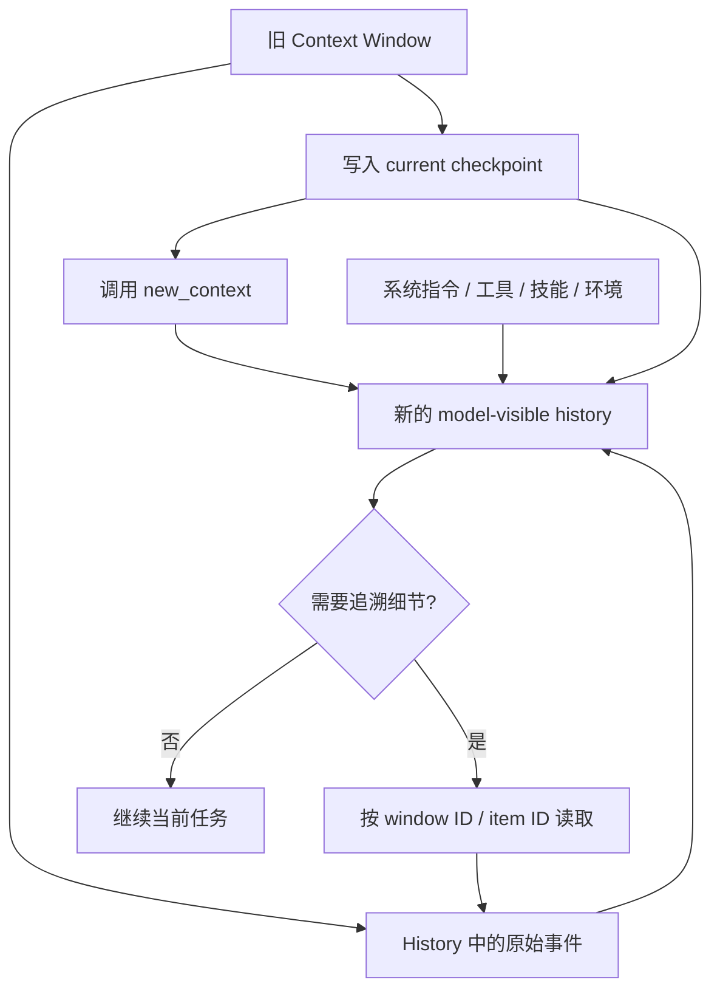

# 超越 Compaction：长时运行 Agent 的上下文管理

大语言模型的上下文窗口正在快速增长，许多前沿模型已经支持百万 token 级输入。然而，对于复杂任务和长程任务而言，即使窗口达到百万 token，甚至再扩大一个数量级，它依然是有限资源，也仍可能在持续执行过程中被迅速耗尽。

更重要的是，上下文窗口能够容纳多少内容，并不等于模型能够稳定、准确地利用多少内容。大量研究表明，随着输入长度增长，模型的信息检索、证据整合和复杂推理能力会明显下降，也就是所谓的 Lost in the Middle 和 Context Rot。

对于需要持续运行、频繁调用工具、跨越多个工作阶段的 Agent 来说，真正的问题已经不只是如何避免超过 token 上限，而是如何长期维护一个短、准、可验证的工作上下文。

本文讨论两种不同的上下文管理思路：Compaction，以及 OpenAI Codex 后来引入的 New Context Window。两者表面上都会在窗口切换前留下少量信息，但它们背后对应的是两种不同的记忆模型：一种尝试压缩历史，另一种则将当前工作状态与原始历史分开保存。

## 长上下文不等于有效上下文

长上下文模型解决了“能否输入更多 token”的问题，却没有完全解决“模型能否可靠利用这些 token”的问题。

ICML 2025 的 [NoLiMa](https://proceedings.mlr.press/v267/modarressi25a.html) 对 13 个宣称支持至少 128K 上下文的模型进行了评估。任务要求模型在问题与证据几乎没有字面重合的情况下，通过语义关联找到相关信息。结果显示，在 32K 输入长度下，11 个模型的成绩已经低于各自短上下文基准的 50%；即使表现较好的 GPT-4o，也从短上下文下的 99.3% 降至 69.7%。

2025 年 Chroma 对 18 个模型进行的 [Context Rot](https://www.trychroma.com/research/context-rot) 实验也得出了相似结论：即使任务复杂度保持不变，输入长度增长仍会使模型表现变得更不稳定。研究覆盖 GPT-4.1、Claude 4、Gemini 2.5 和 Qwen3 等模型，并指出传统 Needle-in-a-Haystack 测试主要考察字面匹配，往往高估模型在真实语义检索和 Agent 任务中的长上下文能力。

这一问题在百万 token 模型上仍然存在。一项 2026 年的[长上下文检索与多跳推理研究](https://arxiv.org/abs/2605.02173)发现，多个前沿模型已经可以在 100 万 token 中完成单一事实检索，但需要跨越中间关系的三跳推理仍会退化。实验中的 GPT-5.5 在 512K 上下文下完成了 5 条推理链中的 4 条，到 1M 时下降到 2 条。这项研究是特定语料和小样本设置下的预印本，不能被当作通用排名，但它说明了一个重要差别：单点检索接近解决，并不代表长上下文中的组合推理也已经解决。

ICML 2026 的 [The First Drop of Ink](https://proceedings.mlr.press/v306/gao26b.html) 则进一步研究了干扰信息。论文发现，只需加入少量高相似度但具有误导性的内容，模型表现就可能快速下降；而过滤上下文带来的收益，很大一部分来自上下文长度本身的降低。这意味着上下文管理不仅是成本优化，也是质量优化。

因此，Agent 的上下文窗口更适合被理解为有限的“注意力预算”，而不是无限扩容的日志容器。Anthropic 在 [Effective Context Engineering for AI Agents](https://www.anthropic.com/research/effective-context-engineering-for-ai-agents) 中也提出，Agent 系统需要持续决定哪些信息应该进入当前窗口，并将 Compaction、记笔记和多 Agent 隔离视为适用于不同任务的上下文管理手段。

这里没有一个适用于所有模型和任务的“推荐有效窗口百分比”。模型页面公开的是容量上限，而不是质量不下降的保证。OpenAI 对 [Compaction](https://developers.openai.com/api/docs/guides/compaction) 的建议也更接近按阈值或阶段管理上下文，而不是承诺窗口中的每个 token 都能被同等可靠地利用。工程上更合理的做法，是根据任务评测决定阈值，并在重要阶段主动收敛上下文。

## Compaction：用压缩表示替代旧历史

Compaction 是最直接的上下文管理思路：读取当前窗口中的对话、工具调用和工具结果，生成一个更小的表示，然后用这个表示替换大部分旧上下文。

OpenAI Responses API 的服务端 Compaction 不一定返回人类可读摘要。它会返回一个不透明的 encrypted compaction item，用较少 token 携带后续推理所需的状态。调用方应将 compacted output 原样用于下一次请求，而不是自行编辑其中内容。

无论输出是自然语言摘要还是 opaque state，核心目标都是一致的：让一个更小的代理表示承担旧历史的职责，使后续请求不再需要携带完整 transcript。


Compaction 的优势在于接入简单、窗口切换对模型相对透明，也能较好地维持连续对话。但它存在一个难以彻底消除的限制：压缩发生时，系统必须提前判断未来还会需要哪些信息。

某段当下看似无关紧要的日志、工具输出字段或用户措辞，可能恰好是后续定位问题所需的关键证据。如果它没有进入 compacted representation，后续模型就无法仅凭这一表示恢复原始信息。

当一个任务经历多次压缩时，这个问题会继续累积：

```text
原始历史
→ 第一次压缩结果
→ “第一次压缩结果 + 新历史”的第二次压缩
→ “第二次压缩结果 + 新历史”的第三次压缩
```

后续压缩可能已经无法访问最初的原始记录，只能继续压缩上一轮留下的代理表示。MemGPT 将 recursive summarization 描述为一种天然有损的机制，并指出长期递归摘要会在系统记忆中形成越来越多的信息空洞。

当然，这并不意味着 Compaction 一定会丢失关键状态。OpenAI 的原生 compaction item 可以保留普通文本摘要难以表达的模型状态；良好的摘要 prompt、合理的 retained items 策略，以及在阶段边界主动 compact，都能显著改善效果。问题在于，Compaction 的结果本身仍然是旧历史的替代物，而不是进入旧历史的索引。

## New Context：状态检查点与可回溯历史

New Context Window 采用了另一种记忆管理思路。它不要求一段 checkpoint 替代整个旧历史，而是将“当前工作状态”与“完整历史证据”分开保存。

在 OpenAI Codex 当前的实现中，当旧窗口接近耗尽时，模型会先写入或更新一个当前检查点（current checkpoint）。它通常只需要记录：

1. 当前理解的任务目标；
2. 用户明确提出的限制和偏好；
3. 当前进展，以及已经完成的工作；
4. 已做出的关键决定及其理由；
5. 已执行的验证及其结果；
6. 尚未解决的问题和风险；
7. 下一步应该做什么；
8. 需要时可以回查的 window ID、item ID、文件、命令或工具结果。

随后，模型调用 `new_context`。Codex 会直接建立一份新的模型可见历史：重新注入系统指令、工具、技能、工作区信息和当前环境状态，并载入 current checkpoint。进入新窗口后，模型首先依据 checkpoint 恢复当前工作状态；需要追溯历史细节时，再通过 History 工具列举和读取相关工具调用、用户消息等原始记录。



因此，New Context 中的 checkpoint 更像“工作状态 + 历史索引”，而不是旧历史的压缩副本。

例如，面对一段两万 token 的测试日志，Compaction 可能尝试把它概括成：

```text
测试失败，原因可能与 token refresh 的并发状态清理有关。
```

New Context 的 checkpoint 可以只写：

```text
token refresh 并发测试失败。当前怀疑失败路径没有清理 refresh state，
但尚未确认。原始测试输出位于 window W、item I；恢复后先读取该 item，
再检查 src/auth/token_refresh.rs。
```

新窗口不需要把这段文字当成已经验证的事实。它可以重新调用：

```text
history.read_item(window_id=W, item_id=I)
```

读取原始工具结果，再基于一手证据继续判断。

这对编码 Agent 尤其重要。许多关键事实存在于大型、结构化的工具结果中，例如：

- 完整测试失败输出；
- 编译器错误和堆栈；
- Git diff；
- API 或数据库响应；
- profiling 结果；
- 静态分析报告；
- 代码搜索结果；
- 用户原始请求中的精确措辞。

如果将这些内容压缩成几句话，模型不仅可能遗漏关键字段，还可能在总结过程中改变原始语义。New Context 的 checkpoint 只需说明“为什么这份证据重要”以及“可以到哪里重新读取它”，待真正需要时，再将原始内容载入当前工作窗口。

Compaction 和 New Context 的区别，可以概括为“历史替代”与“状态索引”的区别。

当前上下文窗口相当于工作内存；checkpoint 保存当前状态和来源指针；History 保存按时间排列的事件记录；workspace 则保存任务执行过程中产生的外部事实。

这种设计的关键并不是 checkpoint 写得比 compaction summary 更好，而是 checkpoint 不需要独自承担保存全部历史的责任。


## New Context 带来的提升

### 1. 从结论变成“结论 + 来源”

传统摘要容易只留下一个判断：

```text
问题可能来自缓存状态。
```

更可靠的 checkpoint 会同时记录：

- 这是已验证结论还是待验证假设；
- 支持这一判断的原始证据在哪里；
- 新窗口应该如何继续验证。

这样，旧判断就能够被重新检查甚至推翻，而不会随着多轮摘要逐渐固化为无法追溯的前提。

### 2. 避免多轮压缩持续放大误差

一次含糊的总结可能在后续压缩中被逐步强化：

```text
第一轮：可能是缓存问题
第二轮：已定位为缓存问题
第三轮：正在修复缓存问题
```

原始日志可能从未证明这一点。New Context 可以将其明确记录为“尚未验证的假设”，同时保留原始 item 的位置，让后续模型重新回到证据本身。

### 3. 更适合结构化工具结果

JSON、测试报告、错误堆栈和代码 diff 都包含大量结构化信息，而自然语言摘要很难预判未来究竟会用到哪个字段。保留原始 item，并在需要时进行有界读取（bounded read），通常比提前压缩全部内容更可靠。

### 4. 减少无关历史对当前推理的干扰

长任务中会积累大量已经失效的信息：旧计划、被推翻的假设、失败命令、过时代码状态和重复搜索结果。New Context 只在当前窗口中保留工作所需的信息，把其他内容留在 History 中按需读取。

这既能降低 token 消耗，也能减少 Lost in the Middle 和干扰信息造成的注意力竞争。

### 5. 跨越多个窗口直接回溯

纯 Compaction 的信息传递通常是线性的：Window 3 依赖 Window 2 的压缩结果，Window 2 又依赖 Window 1 的压缩结果。

New Context 则允许当前窗口直接引用更早窗口的 item。只要历史仍在 retention 范围内、权限有效且数据已经持久化，模型就不需要依靠信息逐窗口复制才能访问早期证据。

## New Context 不是无损记忆

New Context 将主要风险从“摘要是否完整”转移到了“checkpoint 和检索策略是否可靠”。

首先，模型仍然可能遗漏 checkpoint 中的关键信息。原始内容虽然仍保存在 History 中，但如果新窗口不知道它的存在，也没有记录相应的 item ID，就可能无法主动回查。

其次，检索本身是一项需要推理的工作。模型必须决定是否需要查询、搜索哪个窗口、读取哪个 item、读取多少内容，以及某个旧结果是否已经被后续结果取代。LongMemEval 将长期记忆拆成 indexing、retrieval 和 reading 三个阶段，正说明“保存了历史”只是问题的一部分。

此外，读取历史仍然会带来延迟和 token 成本。如果每次切窗后都重新加载大量旧日志，New Context 只是将成本从切窗阶段转移到了后续运行阶段。

## 结语

Compaction 和 New Context 并不是简单的新旧替代关系。

Compaction 适合需要维持连续对话、切窗次数有限、旧历史可以被可靠压缩的任务。它让模型以较低的接入复杂度继续沿用旧状态，OpenAI 的原生 opaque compaction item 也能保留普通文本摘要难以表达的信息。

New Context 更适合工具密集、证据驱动、持续时间很长的 Agent 任务。它不要求 checkpoint 成为整个历史的替代品，而是将当前状态、来源指针、原始事件和工作区事实分层管理。

它最核心的变化可以概括为：

> 从“压缩全部过去”，转向“保存当前状态，并保留回到过去的路径”。

在这种架构里，checkpoint 的质量标准不再是“是否概括了所有历史”，而是：

- 当前目标和限制是否清楚；
- 已确认结论与待验证假设是否被区分；
- 当前进展和后续步骤是否清晰、可执行；
- 关键判断是否指向原始证据；
- 新窗口是否可以用最少上下文恢复工作。

这体现了长时运行 Agent 的一个重要演进方向：从“更长的聊天”，走向“具备可管理记忆的执行系统”。

## 参考资料

- OpenAI：[Compaction](https://developers.openai.com/api/docs/guides/compaction)
- OpenAI：[GPT-5.6 Sol Model](https://developers.openai.com/api/docs/models/gpt-5.6-sol)
- OpenAI：[Run long horizon tasks with Codex](https://developers.openai.com/blog/run-long-horizon-tasks-with-codex)
- Anthropic：[Effective Context Engineering for AI Agents](https://www.anthropic.com/research/effective-context-engineering-for-ai-agents)
- Anthropic：[Effective Harnesses for Long-Running Agents](https://www.anthropic.com/research/effective-harnesses-for-long-running-agents)
- Chroma：[Context Rot: How Increasing Input Tokens Impacts LLM Performance](https://www.trychroma.com/research/context-rot)
- Modarressi et al.：[NoLiMa: Long-Context Evaluation Beyond Literal Matching](https://proceedings.mlr.press/v267/modarressi25a.html)
- Packer et al.：[MemGPT: Towards LLMs as Operating Systems](https://arxiv.org/abs/2310.08560)
- Park et al.：[Generative Agents: Interactive Simulacra of Human Behavior](https://arxiv.org/abs/2304.03442)
- Wu et al.：[LongMemEval: Benchmarking Chat Assistants on Long-Term Interactive Memory](https://proceedings.iclr.cc/paper_files/paper/2025/hash/d813d324dbf0598bbdc9c8e79740ed01-Abstract-Conference.html)
- Gao et al.：[The First Drop of Ink: Nonlinear Impact of Distracting Information in Long-Context Reasoning](https://proceedings.mlr.press/v306/gao26b.html)
