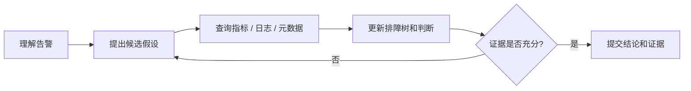
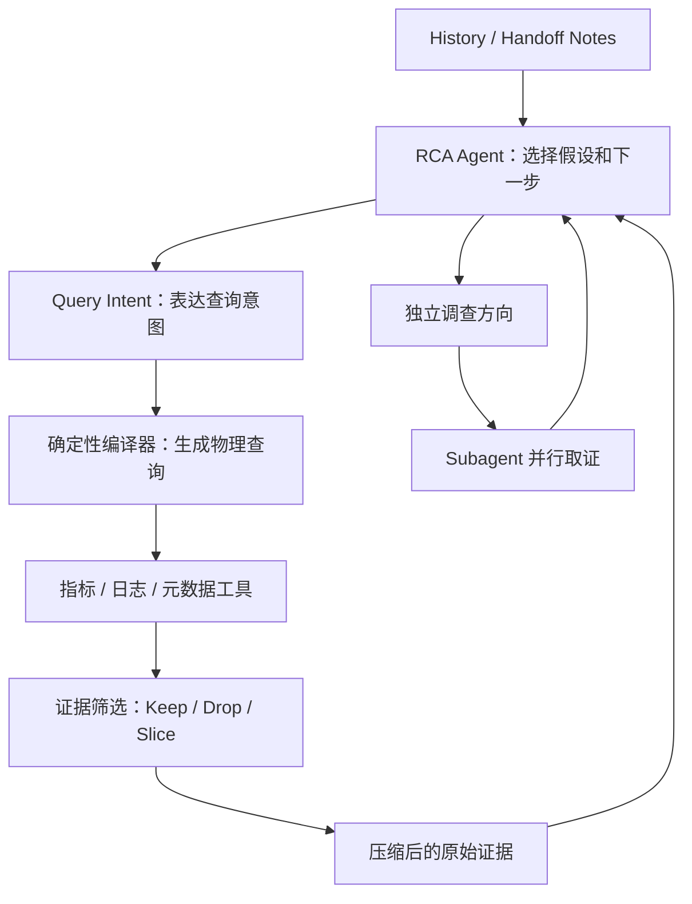
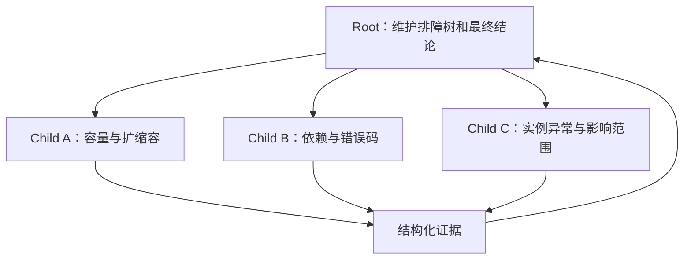
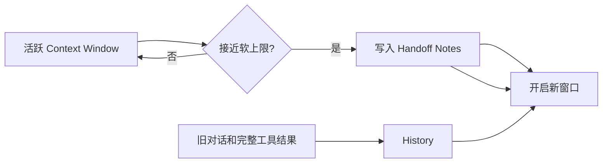

# 从零开发诊断 Agent（六）：RCA Agent 为什么慢，以及我们如何把时间还给诊断

一次 RCA 会话的核心并不复杂：提出假设、查询证据、更新判断。但生产数据告诉我们，Agent 的大部分时间并没有花在“想清楚”上，而是花在生成重复查询、读取海量正常数据、串行等待多个调查方向，以及反复携带越来越长的上下文。

FaultScout 的优化目标不是让模型少思考，也不是为了追求速度而少查证据。恰恰相反，我们想把机械工作从推理回路里移走，让模型把时间用在它真正擅长的事情上：选择假设、判断下一步、综合证据，以及决定调查是否可以结束。

## 一场诊断，时间花在哪里

### 一份有用的 RCA，要说清楚三件事

告警响起之后，值班同学真正需要知道三件事：哪里出了问题，影响了谁，最直接的原因是什么。

FaultScout 希望自动完成证据查询和组织，把业务运行、基础设施和依赖关系串到同一条判断链上，并且让人可以回到原始指标和日志继续核对。目标不是生成一段看起来很完整的文字，而是在事故响应时间内指出异常实体和直接原因，并附上对应证据。

- 关注指标与日志告警，定位到 Pod、Host、API、数据库实例、网卡等具体实体。
- 输出“哪里出问题、为什么、证据是什么”，通常不直接深入代码级修复方案。
- 同时追求速度和准确性：诊断最好在 3～5 分钟内完成，结论还必须能被原始数据复核。

### 为什么 RCA 必然是一条长链路

RCA 不是一次问答。它围绕假设不断查询监控证据，直到证据足以支持结论，或者明确说明还缺什么。



模型选择下一步，Runtime 验收并执行查询，真实证据回到上下文后，模型再修正假设。任何一次多余的模型调用、失败查询或无价值结果，都会被后续轮次继续放大。

因此，端到端耗时可以粗略理解为：串行轮次数量，乘以每一轮的输入处理、输出生成和工具等待时间。要让 RCA 变快，既要减少没有必要的轮次，也要缩短每一轮中与诊断判断无关的工作。

### 先看数据：模型调用仍占掉了大部分时间

在一批 326 个成功会话中，端到端耗时 P50 为 311.5 秒，P90 为 452.0 秒。更长时间范围的样本呈现出同一结构：分析模型耗时占端到端耗时的中位数为 **76.0%**。

输入 token 与端到端耗时的 Spearman 相关系数为 **0.891**，输出 token 的相关系数为 **0.916**。相关性不等于因果，但这个结果足以说明，模型轮次和每轮输入输出是最值得先动的两个杠杆。

我们不是试图让模型“少想一点”，而是要把重复查询、无信息量数据、无依赖等待和历史搬运移出模型循环。

## 真正拖慢诊断的四种机械工作

### 第一种浪费：模型反复手写同一类查询

一条 PromQL、InfluxQL 或日志 SQL 可能很长，但真正承载诊断意图的变量往往很少：查哪个对象、看什么信号、使用什么时间窗、做哪一种分析。其余大部分字符都在重复表达固定的查询骨架和方言细节。

我们统计了一批旧线上样本，其中包含 1,917 个诊断会话和 83,859 次直接原始查询。同期分析模型共输出约 2,946.9 万 tokens，物理查询正文约为 865.6 万 tokens，占全部输出的 **29.4%**；如果扣除模型的推理内容，查询正文约占模型可见输出的 **45%**。

平均每个会话需要输出约 **4,516 个查询正文 tokens**。这些 token 并没有增加诊断信息，它们主要在反复书写指标名、标签过滤、聚合表达式、日志字段和分组语句。

手写物理查询还会带来确定性错误。样本中，原始查询的整体调用失败率为 **4.64%**，其中括号未闭合、字段不存在、字符串未闭合等查询文本错误占 **1.87%**。日志查询更容易出错：全部失败率为 **14.41%**，查询文本错误为 **6.79%**。

工具可以很快发现语法错误，但它无法替模型决定应该怎样修。只要这个调查方向仍要继续，Agent 就必须再进入一轮模型调用，重写查询，然后重新等待工具结果。

### 第二种浪费：把海量正常数据塞回上下文

查询成功也不代表结果适合直接交给模型。

一个真实的指标查询，按 Pod 维度检查两个服务的容器重启数，在 25 分钟窗口内返回了 **1,604 条序列、41,286 个点**。所有序列都为 0，也就是说，几十万个序列化 token 表达的其实只有一句话：没有发现容器重启。

另一个日志查询，在 20 分钟内命中了 **7,669 条**结构高度相似的记录。只保留错误文本就大约需要 38k tokens；如果携带时间、级别、实例等常规字段，规模会超过 300k tokens。

大量正常数据会产生两个问题。第一，模型处理输入的时间和成本明显上升。第二，真正异常的少数信号会被淹没。更多数据并不自动等于更多证据，未经筛选的原始结果反而可能降低诊断质量。

### 第三种浪费：把互不依赖的调查排成串行

一次故障往往同时需要检查容量、依赖、实例异常和影响范围。其中有些步骤必须看到上一批结果才能继续，但另一些方向从一开始就互不依赖。

如果把所有方向都交给一个 Agent 串行推进，总耗时会接近各方向耗时之和。模型还会在方向之间来回切换：查一次容量，回到依赖，再回头补一个容量指标。每次切换都要重新读取相关历史并恢复当前状态。

但并行也不能简单理解为“多开几个 Agent”。如果任务边界、证据引用和最终结论的所有权不清楚，并行只会制造重复查询和相互矛盾的总结。

### 第四种浪费：每一轮都携带更长的历史

查询越多，工具结果、文档、进展记录和中间判断就越多。长会话如果始终完整重放，输入会不断膨胀；如果简单截断，又可能丢掉已经验证过的关键证据。

因此，上下文管理不是“省一点 token”的附属优化，而是长链路能否继续可靠运行的前提。系统既要保留当前排查需要的事实，也要让已经完成、暂时用不到的过程退出活跃上下文。

## FaultScout 的原则：把机械工作移出推理回路

上面四个问题有一个共同点：它们都不是模型必须完成的判断，却会反复占用模型轮次和上下文。

FaultScout 因此把边界划在这里：模型保留假设选择和证据综合；查询生成、结果裁剪、独立方向调度和长会话持久化交给 Runtime。



接下来四个改造，分别对应模型输出查询、工具返回数据、多个方向排队和上下文不断增长这四条等待链路。

## 第一步：让 Agent 表达意图，而不是手写查询

我们把结构化的查询请求称为 Query Intent。用普通话说，它就是让 Agent 只描述“想查什么”，由确定性编译器负责“具体怎么查”。这是查询接口里的表达方式，不是一个新的诊断结论层。

一个 Query Intent 只需要回答四类问题：

- **Object**：要调查的服务、实例、接口或其他对象。
- **Signal**：成功率、错误码、延迟、容量、重启次数等观测信号。
- **Time**：告警时间窗和必要的对比窗口。
- **Action**：趋势、下钻、离群、相关性或日志聚类等分析动作。

编译器负责实体解析、能力选择、模板绑定、查询方言渲染和安全约束注入。同一个意图可以根据数据源确定性生成 PromQL、InfluxQL 或日志 SQL。已有能力走 Query Intent；尚未沉淀的能力仍然允许使用原始查询，避免为了接口统一而丢失探索能力。

```text
模型表达：
  对象：service-a
  信号：成功率
  时间：告警前后 15 分钟
  动作：按 endpoint 下钻

Runtime 负责：
  解析对象 -> 选择数据源 -> 绑定查询模板 -> 生成查询 -> 注入限制 -> 执行
```

对同一组 12 个查询案例，原始查询的完整调用参数平均为 176.4 tokens，Query Intent 平均只需要 34.8 tokens，输出缩短 **80.3%**。结合受控测试中的模型输出速度和历史工具耗时估算，单次查询链路从约 **6.45 秒**降到 **3.85 秒**，平均少等待约 2.6 秒。

两种方式最终执行的是同一条物理查询，所以工具执行时间没有变化。节省来自模型不再反复抄写稳定、冗长的查询语言。编译器自身的 P50 只有约 2.5 毫秒，相比模型和数据源耗时几乎可以忽略。

查询能力也不能完全依赖人工维护。我们把学习过程拆成两层：

1. 每次会话结束后，从成功执行的原始查询中提取候选能力，做确定性校验，但不直接改变线上目录。
2. 定期汇总不同会话的候选、已有看板查询和文档约束，经过审核后版本化发布。

这样，原始查询仍然承担探索职责；一旦某种查询被证明稳定可复用，它就逐渐退出模型输出，成为 Runtime 的确定性能力。

## 第二步：先筛证据，再交给主模型

解决查询生成之后，下一堵墙是查询结果。FaultScout 不再把每个工具的完整结果直接塞给主模型，而是先经过一层证据筛选。

这层只处理单次工具调用的结果，执行三类动作：

| 动作 | 含义 |
| --- | --- |
| `Keep` | 保留有调查价值的原始数据 |
| `Drop` | 删除确定无信息量或高度重复的部分 |
| `Slice` | 保留异常序列、时间窗口或代表样本 |

它不读取 RCA Agent 的完整推理，也不做跨工具归因，更不会直接生成根因结论。输出仍然是同类型的原始数据子集，只是规模更适合主模型消费。

### 先用确定性算法缩小范围

当前实现主要使用几类确定性方法：

- **离群检测**：先筛异常序列，再截取序列内部的异常时间窗口。
- **维度下钻**：逐层定位对异常贡献较高的维度值或组合。
- **相关性分析**：保留与目标序列存在同窗、领先或滞后关系的候选信号。
- **日志解析**：将可变字段参数化，按稳定结构聚类，保留异常模板和代表样本。

这些算法的任务是缩小输入范围，而不是替主模型解释因果。比如一个维度贡献了大部分错误，只能说明它值得继续调查，不能直接证明它就是根因。

### 筛选不可靠时，宁可少压缩

证据筛选最重要的约束是高召回。只要系统无法确认压缩后仍能保留异常，就不应该返回一个看起来干净、实际遗漏关键线索的结果。

我们的降级顺序是：少量候选保留数值文本；高基数时间序列可以转为折线图或热力图；图形仍不适合时，回退到原始结果。图片负责保留整体形态、异常实体和时间窗口，精确数值仍然放在 History 中按需读取。

这个分界可以用 token 规模说明。100 条序列使用紧凑 JSON 约需要 19,402 tokens，紧凑文本约需要 11,299 tokens，而一张热力图输入约为 425 tokens，分别减少 **97.8%** 和 **96.2%**。但只有 1 条序列时，文本只需要约 112 tokens，图片反而更大。所以多模态是高基数结果的降级表达，不是所有数据的默认格式。

## 第三步：并行推进真正独立的调查方向

FaultScout 只把真正独立的方向交给 Subagent。Child Agent 在明确边界内完成多轮查询，Root Agent 汇总经过验证的证据，并独占最终结论。



并行前必须先说清楚四件事：调查方向、可使用的数据范围、结束条件，以及交付给 Root 的证据格式。Child 不负责宣布根因，也不能把“没有发现异常”自动解释成该方向已经排除。最终判断仍由掌握全局证据的 Root 完成。

这类并行的价值不是让多个 Agent 重复检查同一件事，而是减少 Root 在互不依赖方向上的串行等待。

## 第四步：让长会话的上下文保持可控

即使模型支持很长的上下文窗口，也不能无限堆叠历史。FaultScout 使用两类机制控制活跃上下文。

第一类是渐进式披露。数据源目录、日志字段、查询语言指南等信息不再从第一轮开始完整携带，而是先提供一个小索引，在确实需要某种能力时再加载详情。凭据和连接信息始终留在 Runtime，不进入模型上下文。

第二类是显式上下文轮换。当活跃上下文接近软上限时，Agent 生成一份 Handoff Notes，记录当前目标、已确认事实、未完成节点和关键证据引用，然后开启新的 Context Window。旧对话和完整工具结果进入 History，后续按标识读取。



它不是按消息条数做简单滑窗，也不是依赖模型服务自动压缩。哪些事实必须继续携带、哪些内容可以退到 History，由诊断状态和证据引用明确决定。

## 怎么判断这些优化没有伤害诊断质量

速度优化很容易走偏：少查几个指标、截断更多内容，端到端耗时当然会下降，但这不代表 RCA 变好了。

我们的判断标准始终是：相同问题上，最终结论仍有足够证据支持，关键异常没有因为压缩或并行而丢失，同时机械开销明显下降。

因此，每一层都有自己的验收边界：

- Query Intent 必须编译为与原始路径等价的物理查询；不能识别时回退到原始查询。
- 证据筛选优先保证异常召回；不确定时少压缩或回退完整结果。
- Subagent 只能处理边界清晰的独立方向；最终判断权留在 Root。
- Context Window 轮换必须保留已确认事实、未完成工作和可追溯的证据引用。

这些边界也说明了一个更通用的 Agent 工程原则：确定性的事情尽量交给系统，存在语义取舍的事情留给模型；优化系统吞吐时，不能顺手把不确定性藏起来。

## 结语：速度来自少做机械工作，不是少看证据

FaultScout 的四个改造看起来分散，实际都在做同一件事：把模型不擅长、却会反复消耗 token 和轮次的机械工作移出推理循环。

- **Query Intent** 让模型表达“要查什么”，查询语言、字段和安全约束交给确定性编译器。
- **证据筛选** 先从海量结果中保留值得调查的原始数据，让主模型不必在正常噪声里找异常。
- **Subagent** 只接手真正独立的调查方向，减少 Root 后续的串行等待。
- **Agent Harness** 让文档、工具结果和历史按需进入上下文，并通过 Handoff Notes 与 History 保持长会话连续。

这些优化没有减少 RCA 需要看的证据。相反，它们让每一次模型调用都更接近真正的诊断动作：提出假设、选择下一步、理解证据，以及判断什么时候可以结束调查。

RCA Agent 跑得快，不是因为它少查了，而是因为它不再把时间浪费在重复写查询、搬运正常数据和重做已经完成的工作上。
